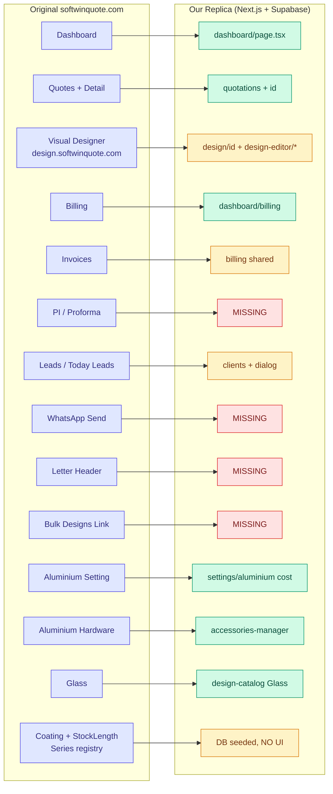
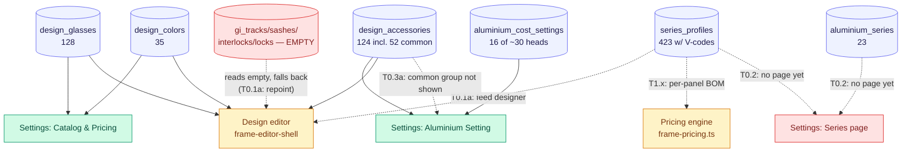

# SoftWinQuote Replica — Gap Analysis

Comparison of the original **softwinquote.com** (+ designer app **design.softwinquote.com**)
against our replica in this repo. Produced by crawling the authenticated original
and reading our codebase.

> Method: Logged into the original via session cookie, crawled every sidebar
> module (raw HTML saved under `swq_pages/`), fetched a real quotation detail
> page (full design JSON exposed in a `console.log`), and downloaded the designer
> SPA bundle. Then mapped each against our `app/`, `components/`, `lib/`, and SQL.

---

## 0. Task checklist (remaining work)

Ordered by priority. Details for each are in the sections below. Check off as done.

> **DB migration status (verified):** `updates.sql` + `seed.sql` have been run in
> the Supabase SQL Editor and merged into `supabase_setup.sql`. Row counts
> confirmed: glass **128**, accessories **124**, series **23**, series_profiles
> **423**, colors **35**. `updates.sql` is back to empty. Re-run the seed with
> `node swq_pages/extract.js && node swq_pages/fetch-api.js && node swq_pages/gen-seed.js`.

### Phase 0 — fix the seed wiring (data is in the DB but not usable yet)
- [x] **T0.1** Real series-scoped profile data fetched from the designer API
  (`/api/aluminium/getProfiles`) and seeded into `series_profiles`
  (423 rows across 23 series, each with `profile_code` + `thickness`). The flat
  `gi_*` tables are superseded for BOM costing. See §6.1.
  - [ ] **T0.1a** Repoint the designer at `series_profiles` (it still reads the
    empty `gi_*` tables → falls back to hardcoded defaults). Overlaps with T1.x.
  - [ ] **T0.1b** Decide the fate of `gi_tracks/gi_sashes/gi_interlocks/gi_locks`
    (retire + drop, or keep as a non-series fallback). Remove their `ListManager`
    cards from `design-catalog` if retired.
- [ ] **T0.2** Surface the series + profiles data (currently in DB, no UI/reader).
  - [ ] **T0.2a** Build a Settings page "Aluminium Series" listing
    `aluminium_series` (Company / Series / Available Length), add/edit/delete.
  - [ ] **T0.2b** On that page, drill into a series to list/edit its
    `series_profiles` grouped by `profile_group` (track/sash/mesh_sash/…).
  - [ ] **T0.2c** Add the page to the Settings nav (`settings/layout.tsx`).
- [x] **T0.3** Added a `common` accessory kind (DB CHECK + seed). The 52
  consumables now seed as `kind='common'`. See §6.3.
  - [ ] **T0.3a** Add a "Common / Consumables" group to `ACCESSORY_KINDS` +
    `GROUP_ORDER` in `components/settings/accessories-manager.tsx` so the 52
    rows render under their own heading instead of hidden/ungrouped.
- [ ] **T0.4** Full aluminium cost sheet (currently 16 of ~30 heads).
  - [ ] **T0.4a** Add columns to `aluminium_cost_settings` (via `updates.sql`):
    `dustpad, outer_clit, sash_clit, l_pati, lockguide_cap, interlock_cap,
    bubstopper, ugid, lockguid, water_drainage, brassrubber, suitbelt,
    slim_width_overlap`.
  - [ ] **T0.4b** Add them to `COST_FIELDS`/`OVERLAP_FIELDS` +
    `CostSettings`/`DEFAULTS` in `components/settings/aluminium-cost-manager.tsx`.
  - [ ] **T0.4c** Extend `gen-seed.js` cost-head mapping + reseed so values load.

### Phase 1 — close the costing gap (biggest correctness issue)
- [x] **T1.1** Company+Series profile catalog wired into the designer: real
  Series dropdown (`aluminium_series`) + series-scoped profiles
  (`series_profiles`) resolved per design. `FrameDetails.seriesId` drives it.
- [~] **T1.2** Mesh: cut-list + hardware are summed by the BOM engine, but a
  fully separate costed mesh panel (meshSash/clip/slim as its own M-panel) is
  still simplified. Revisit if mesh accuracy matters.
- [x] **T1.3** New **weight-based BOM engine** `lib/design-editor/bom-pricing.ts`:
  `aluminium = Σ(cut_length_m × weight_per_meter) × rate`, + coating + glass +
  hardware + consumables + labour + profit%. Replaces area×type-rate when a
  series is selected (legacy engine kept as fallback). `weight_per_meter`
  editable per profile to tune further.
- [x] **T1.5 (calibration)** Scraped **73 real quotation panels** from the
  original (`swq_pages/cal/samples.json`) and grid-searched the engine
  parameters against them. Result: **MAPE ~17%, near-zero bias** (casement 10%,
  door 15%, sliding 20%); the original reference sample now predicts within
  ~3%. Calibrated defaults baked in: group weights (track 0.8 / sash 0.5 /
  interlock 1.2 kg/m), per-type hardware allowance (sliding ₹7000, casement
  ₹300, door ₹1500), and perimeter-proportional consumables.
- [x] **T1.4** Per-section BOM breakdown persisted to
  `window_designs.panel_details` (JSONB) on save; live breakdown shown in the
  designer's details panel (weight, aluminium, glass, hardware, labour, profit).

> **DB (Phase 1, applied + merged):** `series_profiles.weight_per_meter`
> (kg/m, group-default backfill) and `window_designs.panel_details` (JSONB).
> `weight_per_meter` editable in Settings → Aluminium Coating per profile.

### Phase 2 — missing revenue/workflow modules
- [ ] **T2.1** WhatsApp send (`/whatsapp`) — one-click PDF to client.
- [ ] **T2.2** Letter Header (`/letter-header`) — company letterhead on PDFs.
- [ ] **T2.3** PI / Proforma (`/performas`) — proforma invoices.
- [ ] **T2.4** Split Invoices into its own module (currently folded into Billing).

### Phase 3 — CRM + settings parity
- [ ] **T3.1** Leads (`/leads`) — lead capture.
- [ ] **T3.2** Today Leads (`/today_call`) — daily call list.
- [ ] **T3.3** Aluminium Coating + StockLength settings pages (the
  `aluminium_series` UI from T0.2).
- [ ] **T3.4** Bulk Designs Link (`/quotation-pdf-jobs`) — batch PDF jobs.

### Phase 4 — nice-to-have
- [ ] **T4.1** CRMS SSO (`/open-crms`) — jump to external CRM (if one exists).
- [ ] **T4.2** Tutorial parity (`/tutorial`).

---

## 1. What the original is

- **Main app**: Laravel server-rendered app (jQuery + Bootstrap). Login →
  redirects to `/quotations`.
- **Designer app**: a **separate React + Vite SPA** hosted at
  `design.softwinquote.com`, opened with `?quotationId=...`. It writes the
  design back to the quotation. Single JS bundle (~726 KB).
- **Data model** (from a real quotation): each design stores BOTH
  - `design_json` — visual geometry: blocks → sections → window + props
    (couplers, panels, mesh flags).
  - `data[]` — the **costed** breakdown: per-panel hardware with real catalog
    codes (`track: V-2714`, `sash: V-2721`, `interlock/slim: V-2732`,
    `handle: METRO HANDLE`, `roller`, `lock`), series (`27mm window series`),
    `sliderType: slim`, profile company (`Vitco`), and a computed
    `cost` per panel (e.g. `26968`).

---

## 2. Module-by-module status

Legend: ✅ built · 🟡 partial · ❌ missing

| Original module | Route | Our equivalent | Status |
|---|---|---|---|
| Dashboard | `/dashboard` | `app/(dashboard)/dashboard/page.tsx` | ✅ |
| Quotes (list + detail) | `/quotations` | `.../quotations` + `[id]` | ✅ |
| Quotation pricing | in detail | `.../quotations/[id]/pricing` | ✅ |
| Quotation reports | in detail | `.../quotations/[id]/reports` | ✅ |
| Visual designer | `design.softwinquote.com` | `app/design/[id]` + `components/design-editor/*` | 🟡 |
| Billing | `/billings` | `.../billing` | ✅ |
| Invoices | `/invoices` | `.../billing` (shared) | 🟡 |
| PI / Proforma | `/performas` | — | ❌ |
| Leads | `/leads/` | `components/crm/*`, clients | 🟡 |
| Today Leads | `/today_call` | — | ❌ |
| Opportunities | `/opportunities` | — | ❌ (commented out in original too) |
| CRMS (external SSO) | `/open-crms` | — | ❌ |
| WhatsApp send | `/whatsapp` | — | ❌ |
| Letter Header | `/letter-header` | — | ❌ |
| Bulk Designs Link | `/quotation-pdf-jobs` | — | ❌ |
| Tutorial | `/tutorial` | `app/(docs)/docs/*` | 🟡 |
| Profile / user edit | `/users/{id}/edit` | `.../admin/users/[id]` | ✅ |
| Admin users/permissions | — | `.../admin/*` | ✅ (ours is extra) |
| **Settings — Aluminium Setting** | `/aluminium_setting` | `.../settings/aluminium` | ✅ |
| **Settings — Aluminium Hardware** | `/aluminium_accessories` | `components/settings/accessories-manager` | ✅ |
| **Settings — Aluminium Coating** | `/coatings` | — | ❌ |
| **Settings — Aluminium StockLength** | `/aluminium_stock` | — | ❌ |
| **Settings — Glass** | `/glass` | `design-catalog` (design_glasses) | ✅ |

### Settings sub-modules — verified detail

Actual column structures from the crawled original (corrects earlier guesses):

| Original page | Columns in original | Our implementation | Status |
|---|---|---|---|
| Aluminium Setting | `S.N · Cost heads · Price` (flat rate list + "Update All") | `settings/aluminium` cost manager | ✅ |
| Aluminium Hardware | `Type · Name · Code · Price` | `accessories-manager.tsx` — Name + **Code** + Price, grouped by kind (sash/interlock/handle/roller/lock/hinge + full mesh set) | ✅ |
| Glass | `Name · Price` | `design-catalog` → `design_glasses` ListManager (`rate_per_sqft`) | ✅ |
| **Aluminium Coating** | `Company · Series · Action` | — | ❌ |
| **Aluminium StockLength** | `Company · Series · Available Length · Action` | — | ❌ |

**Important correction:** "Aluminium Coating" (`/coatings`) is **not** paint/colour. It
is a **profile Company + Series registry** (e.g. company "Vitco", series
"27mm window series"). Together with StockLength (same Company/Series + an
available-length field) it defines the profile catalog that the designer's
series/track dropdowns and the per-panel costing read from.

We have per-hardware `profile_code` columns (`gi_tracks/sashes/interlocks/locks`)
but **no Company→Series registry table** and no stock-length table. This is the
missing backbone for the series/profile costing gap noted in §3.2–3.3.

---

## 3. The designer — brought over, but with gaps

Our repo **already re-implements** the designer in-app (not as a separate SPA):

- `lib/design-editor/frame-model.ts` — blocks → sections → couplers/mullions →
  window types → sliding panels. Window-type catalog matches the original's
  bundle 1:1 (fixed, sliding, casement, louvered, tophung, awning, doors,
  mesh-screen, ventilator, skylight, roller-shutter/blind, grille, etc.).
- `components/design-editor/*` — canvas, tool rail, details panel, renderers.
- `store/frame-editor.ts`, `app/design/[id]/page.tsx`.

### Gaps inside the designer

1. **Mesh sub-system (🟡 partial).**
   Original models a full mesh panel with its own hardware:
   `meshSash`, `meshType` (e.g. "Aluminium Mesh"), `meshHandle` ("Touch Lock"),
   `meshClip` (`V-2514`), `meshSlim` (`V-2732`), `meshDivider`, `meshLeft/Right`,
   and a mesh roller. A sliding window emits a **separate costed `mesh-screen`
   panel (M1)**. Ours has only a `mesh: boolean` flag + a standalone
   `mesh-screen` type — no mesh hardware breakdown and no mesh panel costing.

2. **Series / profile code system (🟡 metadata only).**
   Original: `seriesId`, `seriesName` ("27mm window series"), `sliderType`
   ("slim"), `trackCode` ("V-2714"), profile company ("Vitco"). These drive the
   hardware **catalog codes** (V-xxxx) and therefore the price. Ours has
   `series?: string` explicitly marked *"does not change pricing"*.

3. **Costing engine mismatch (🟡 fundamentally different).**
   - Original: **per-panel hardware costing** — each panel sums the cost of its
     real catalog pieces (track + sash + interlock + handle + roller + lock +
     mesh parts) → panel `cost` (e.g. `26968`) → design total.
   - Ours (`lib/design-editor/frame-pricing.ts`): **area × type-rate curve** +
     GST/install percentages. Accessory prices are optional add-ons, not a
     catalog-code BOM.
   - Result: our numbers are plausible but won't match the original's quotes.

4. **Persisted `data[]` breakdown (❌).**
   Original stores the costed per-panel array (`panel_details`, `data`) with
   hardware codes alongside geometry. We store geometry + an aggregate amount,
   not the per-panel hardware BOM.

5. **Architecture note (not a user-facing gap).**
   Theirs is a standalone SPA on a subdomain that round-trips via `quotationId`.
   Ours is a Next.js route. Functionally equivalent; no action needed unless
   parity with their URL scheme matters.

---

## 4. Missing modules (highest value first)

1. **WhatsApp send** (`/whatsapp`) — core selling point: one-click PDF to
   client's WhatsApp. Not present.
2. **Letter Header** (`/letter-header`) — company letterhead/branding applied to
   PDFs. Not present (we have `lib/email/brand-template.ts` for email only).
3. **PI / Proforma** (`/performas`) — proforma invoices, distinct from invoices.
4. **Invoices as its own module** — original separates Billing, Invoices, and PI;
   ours folds them into one `billing` area.
5. **Leads / Today Leads CRM** (`/leads`, `/today_call`) — lead capture + daily
   call list. We have a lightweight client dialog only.
6. **CRMS SSO** (`/open-crms`) — single-sign-on jump to an external CRM. Likely
   out of scope for a replica, but it's a visible nav item.
7. **Bulk Designs Link** (`/quotation-pdf-jobs`) — batch PDF generation jobs.
8. **Settings sub-modules** — **Aluminium Coating** (`/coatings`, a profile
   **Company + Series registry**) and **Aluminium StockLength** (`/aluminium_stock`,
   Company + Series + available length) have no equivalent. These define the
   profile catalog that feeds the designer's series/track selection and the
   per-panel costing — so they are a prerequisite for closing the costing gap in
   Phase 1. **Hardware** and **Glass** managers are already done (✅).

---

## 5. Suggested build order

**Phase 1 — close the costing gap (biggest correctness issue)**
- Add a hardware **catalog with codes** (V-xxxx) tied to series/profile.
- Extend the mesh model (sash/type/handle/clip/slim/divider + roller).
- Rework `frame-pricing.ts` to a **per-panel BOM** engine; persist a `data[]`
  breakdown on each design.

**Phase 2 — missing revenue/workflow modules**
- WhatsApp send, Letter Header, PI/Proforma, split Invoices out of Billing.

**Phase 3 — CRM + settings parity**
- Leads + Today Leads, Aluminium Coating, StockLength, finish Glass/Hardware
  managers, Bulk Designs Link.

**Phase 4 — nice-to-have**
- CRMS SSO (if an external CRM exists), Tutorial parity.

---

## 6. Seeded data — where it lands in the app (Phase 0 detail)

We scraped the original's catalog (settings pages **and** the designer API) and
seeded it (see `seed.sql`). Verified DB counts: **128 glass**, **124
accessories**, **23 series**, **423 series_profiles**, **35 colors**. Here is
exactly where each shows up — and the wiring still to do.

| Seeded table | Rows | Shows in app at | Reader | Status |
|---|---|---|---|---|
| `design_glasses` | 128 | Settings → Catalog & Pricing → "Glass Types" | `ListManager` + designer | ✅ visible |
| `design_colors` | 35 | Settings → Catalog & Pricing → "Colours" | `ListManager` + designer | ✅ visible |
| `design_accessories` | 124 | Settings → Aluminium Setting → "Accessories" | `accessories-manager.tsx` + designer | 🟡 `common` group not rendered (T0.3a) |
| `aluminium_cost_settings` | 1 | Settings → Aluminium Setting (top) | `aluminium-cost-manager.tsx` | 🟡 only 16 of ~30 heads (T0.4) |
| `aluminium_series` | 23 | **nowhere** | **none** | ❌ no UI/reader (T0.2) |
| `series_profiles` | 423 | **nowhere** | **none** | ❌ no UI/reader (T0.2, T0.1a) |
| `gi_tracks/sashes/interlocks/locks` | **0** | Settings → Catalog & Pricing | designer `frame-editor-shell.tsx` | ❌ empty, superseded by `series_profiles` (T0.1a/b) |

### 6.1 — Profile data location + designer wiring (T0.1 — DONE; T0.1a/b open)
The real profile catalog is **not** on the settings pages — it lives behind the
designer API. Fetched via the bundle's bearer token:
- `/api/aluminium/getSeries` → 23 series (+ ids)
- `/api/aluminium/getProfiles?series_name=…` → per-series tracks/sashes/
  mesh_sashes/interlocks/clips/mullions/slim_interlocks with `profile_code`
  (e.g. `V-2714`) + `thickness`
- `/api/getColors` → 35 colours (RAL names + hex), `/api/getAllGlasses` → 102.

Seeded into `aluminium_series` (+ `external_id`, `material`) and the new
`series_profiles` table (423 rows). Scraper: `swq_pages/fetch-api.js` →
`swq_pages/api/catalog.json`.

**Still open:** the designer (`components/design-editor/frame-editor-shell.tsx`)
reads the empty `gi_tracks/gi_sashes/gi_interlocks/gi_locks` tables and falls
back to hardcoded `FALLBACK_LISTS`. **T0.1a** repoints it at `series_profiles`
(filtered by the chosen series); **T0.1b** retires the `gi_*` tables + their
`ListManager` cards. Recommended because `series_profiles` is series-scoped and
matches the real model.

### 6.2 — `aluminium_series` + `series_profiles` are orphaned (T0.2)
No component queries either table. The 23 series and 423 profiles are in the DB
but there is no page to view/edit them and the designer doesn't read them yet.
Needs a Settings page: list series (T0.2a), drill into a series' profiles
grouped by `profile_group` (T0.2b), and a nav entry (T0.2c). This is the real
"Aluminium Coating / StockLength" settings surface (also tracked as T3.3).

### 6.3 — `common` consumables (T0.3 — schema DONE; T0.3a UI open)
The `common` kind was added to the `design_accessories.kind` CHECK and the 52
misc consumables (glass packers, espags, gaskets, blocks…) now seed as
`kind='common'`. **Still open (T0.3a):** `accessories-manager.tsx` doesn't list
a "Common" group in `ACCESSORY_KINDS`/`GROUP_ORDER`, so those 52 rows don't yet
render under their own heading. Add the group to display them.

### 6.4 — Cost sheet is incomplete (T0.4 — open)
`aluminium_cost_settings` has columns for 16 of the original's ~30 cost heads.
These original heads have **no column** and were not seeded: `dustpad`,
`outer_clit`, `sash_clit`, `l_pati`, `lockguide_cap`, `interlock_cap`,
`bubstopper`, `ugid`, `lockguid`, `water_drainage`, `brassrubber`, `suitbelt`,
`slim_width_overlap`. Add columns via `updates.sql` (T0.4a), extend
`COST_FIELDS`/`OVERLAP_FIELDS` + `CostSettings`/`DEFAULTS` in
`aluminium-cost-manager.tsx` (T0.4b), and extend `gen-seed.js` + reseed (T0.4c).
These feed the BOM engine (Phase 1).

---

## 7. Visual map — original vs our replica

Legend: 🟩 built · 🟨 partial · 🟥 missing (colours render in Mermaid preview).

### 7.1 — Module mapping (original → ours)

### 7.2 — Catalog data flow (what's wired vs orphaned)

Shows how the seeded catalog tables feed the designer + pricing. Dashed red
edges are the **not-yet-wired** paths (the Phase 0 tasks).

- Crawled original HTML: `swq_pages/*.html` (17 modules + quotation detail).
- Designer bundle: `swq_pages/designer/bundle.js` (React/Vite SPA).
- Real design JSON sample: see `console.log(...)` in
  `swq_pages/quotation_detail.html` (block/section/panel/mesh/series schema with
  live hardware codes and `cost`).
- Extracted settings-page data: `swq_pages/extracted.json` (glass, accessories,
  coatings/series, cost heads). Scraper: `swq_pages/extract.js`.
- Extracted designer-API data: `swq_pages/api/catalog.json` (series, 423
  series-scoped profiles, 35 colours). Scraper: `swq_pages/fetch-api.js`
  (uses the designer bundle's hardcoded bearer token).
- Seed generator: `swq_pages/gen-seed.js` → emits `seed.sql` (root).
  Full re-run after schema/data changes:
  `node swq_pages/extract.js && node swq_pages/fetch-api.js && node swq_pages/gen-seed.js`
